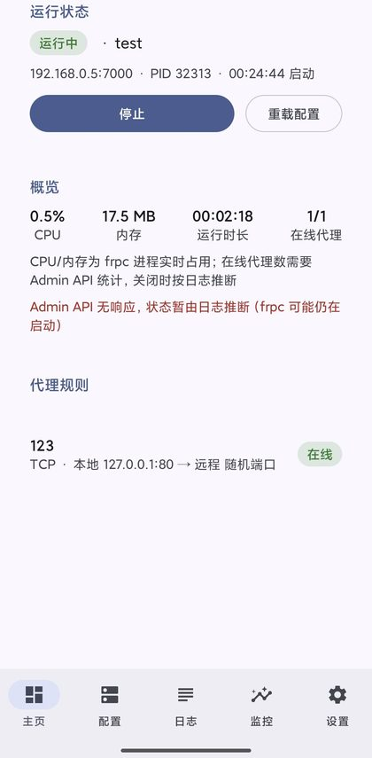
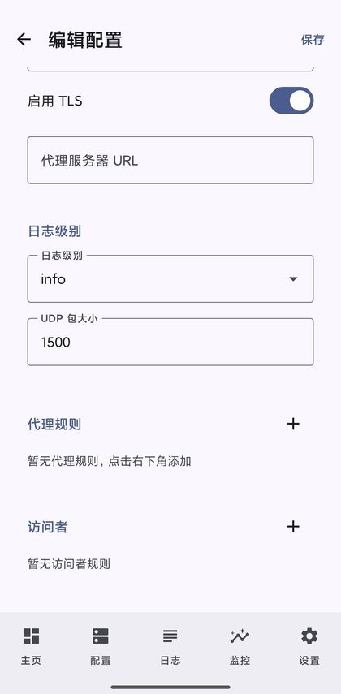
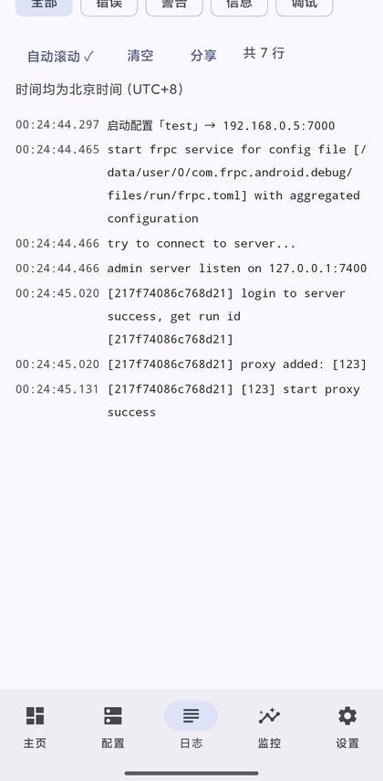
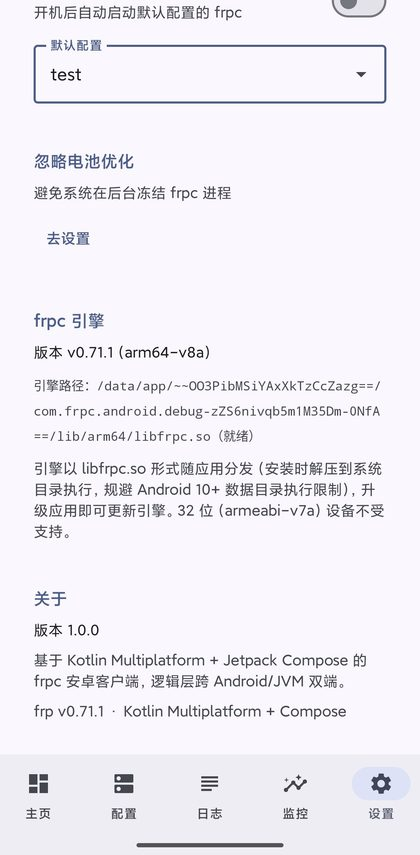

<div align="center">
  
  <h1>Frpc Client · Android</h1>
  <p><b>Visual config · One-tap start/stop · Live logs · Runtime monitoring</b><br>Manage frpc (intranet tunneling) on your phone like a desktop client</p>

  <p>
    
    
    
    
  </p>

  <p><b>English</b> · <a href="README.md">简体中文</a> · <a href="docs/wiki/Home.md">Wiki</a></p>
</div>

---

## Why

Running [frp](https://github.com/fatedier/frp) on a phone usually means hand-editing `frpc.toml` in a terminal emulator, or using a shell app that only gives you a start/stop button.

This project brings the desktop-style workflow (see [frpc-desktop](https://github.com/luckjiawei/frpc-desktop)) to Android: **visual configuration, process supervision, logs and monitoring**, built natively.

- **Native**: Kotlin + Jetpack Compose, no WebView runtime. Release APK ~7.5MB (≈6MB of that is the frpc engine itself).
- **Shared logic**: Kotlin Multiplatform — config model, TOML codec, status API client and process metrics are reused on Android and JVM, with tests on both targets.
- **Works on real devices**: handles Android 10+ exec restrictions (W^X), foreground service keep-alive, boot auto-start and battery optimization guidance.

## Features

| Area | Capabilities |
| --- | --- |
| Config | Multiple server profiles, all proxy types (tcp/udp/http/https/stcp/sudp/xtcp/tcpmux), visitors, type-aware forms, required-field validation, port-conflict pre-check, `frpc.toml` import/export |
| Control | Foreground service, graceful stop, hot reload, crash auto-restart (exponential backoff, max 5), boot auto-start |
| Monitoring | Proxy status (status API first, log inference fallback), live CPU/memory sampling, uptime, thread count, process state |
| Logs | Real-time parsing (level/source/time), 3000-line ring buffer, level filter, auto-scroll, copy/share |
| Notification | Ongoing summary (server / online proxies / uptime / CPU / memory), refreshed every 5s, one-tap stop |
| Web console | The official frpc dashboard is bundled — open `http://127.0.0.1:7400/static/` in the phone browser |
| Transports | tcp / kcp / quic / websocket / wss, TLS toggle, per-proxy encryption & compression |

## Screenshots

<table>
  <tr>
    <td align="center"><br><sub>Status &amp; proxies</sub></td>
    <td align="center"><br><sub>Config editor</sub></td>
    <td align="center"><br><sub>Live logs</sub></td>
    <td align="center"><br><sub>Engine &amp; settings</sub></td>
  </tr>
</table>

## Quick start

1. Download `frpc-android-*.apk` from [Releases](https://github.com/OWNER/REPO/releases/latest)
2. Allow installation from unknown sources
3. Open the app → **Configs** → create a profile (frps address, port, token)
4. Add a proxy rule (e.g. TCP local 22 → remote 6001) → save
5. Tap **Start** on the Home tab

> Keep "status monitoring" enabled in the profile: the app uses it for real assigned ports, online state and CPU/memory. It only listens on `127.0.0.1`.

## frp compatibility

Bundled frpc **v0.71.1**. Verified against frps v0.71.1 with real binaries (login + status API + real data round-trip):

| Capability | Result | Server requirement |
| --- | --- | --- |
| tcp (TLS on/off) | ✓ | — |
| websocket | ✓ | — |
| kcp | ✓ | `kcp_bind_port` **must equal** client `serverPort` |
| quic | ✓ | `quic_bind_port` **must equal** client `serverPort` |
| stcp / xtcp | ✓ | — |
| sudp | ✓ | — (visitor mode) |
| http | ✓ | `vhost_http_port` + `customDomains` |
| https | ✓ | `vhost_https_port`; local service must speak HTTPS |
| tcpmux | ✓ | `tcpmux_httpconnect_port` |
| wss | ✗ | Needs an external TLS reverse proxy in front of frps |

**Key takeaway**: frpc never rewrites the port for `kcp`/`quic` — it always dials `serverAddr:serverPort`, so the server listen port must match what you configure in the app.

## Build

Requires **JDK 17+**, **Android SDK** (platform 36, build-tools 36.0.0) and **Go 1.26+** (engine rebuild only).

```bash
echo "sdk.dir=$HOME/Android/Sdk" > local.properties
./gradlew :shared:jvmTest :androidApp:testDebugUnitTest
./gradlew :androidApp:assembleDebug          # debug APK
./gradlew :androidApp:assembleRelease        # unsigned unless KEYSTORE_* env vars are set
FRP_VERSION=v0.71.1 bash scripts/build-frpc.sh   # rebuild engine
```

## Automation

`.github/workflows/release.yml` checks frp releases daily, rebuilds the engine, runs tests, builds a signed APK and publishes a release tagged `frp-<version>`. Push a `v*` tag for an app release, or trigger the workflow manually.

Secrets for signing: `KEYSTORE_BASE64`, `KEYSTORE_PASSWORD`, `KEY_ALIAS`, `KEY_PASSWORD`.

`ci.yml` runs unit tests, lint (non-blocking), a debug build and an engine reproducibility check on every push/PR.

## Known limitations

- Importing `frpc.toml` drops fields that are not modeled (plugin, healthCheck, annotations, metadatas, featureGates, includes, loadBalancer)
- **arm64-v8a only** in the shipped APK (Go cannot statically link android/arm 32-bit; upstream frp ships arm64 as well). x86_64 can be enabled at build time
- wss requires an external TLS proxy (see matrix)

## Contributing

Issues and PRs are welcome — see [CONTRIBUTING.md](CONTRIBUTING.md) and [CODE_OF_CONDUCT.md](CODE_OF_CONDUCT.md). Please report security issues privately per [SECURITY.md](SECURITY.md).

## License

MIT for this project's code. The bundled frpc engine is [fatedier/frp](https://github.com/fatedier/frp) (Apache-2.0) — see [NOTICE](NOTICE).
