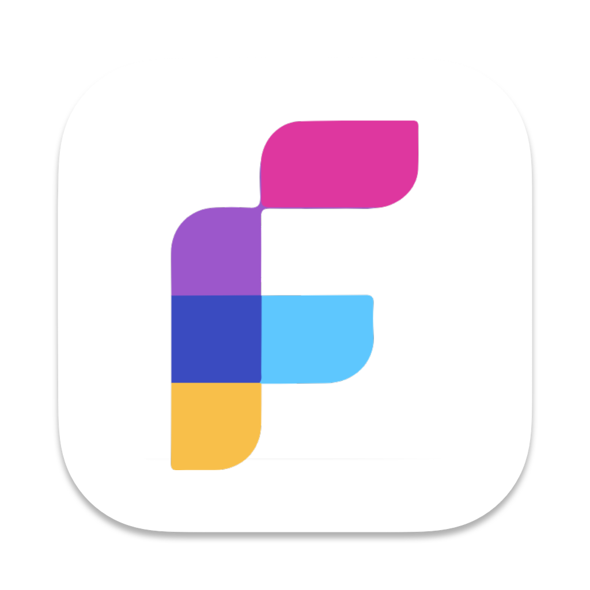
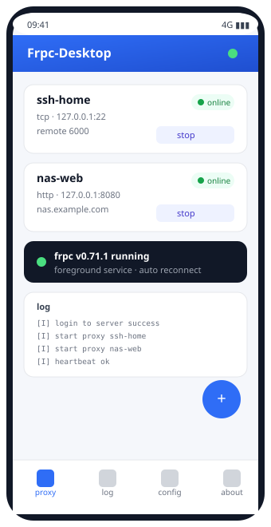

<a name="readme-top"></a>

<!-- PROJECT SHIELDS -->
[![Downloads][downloads-shield]][downloads-url]
[![Forks][forks-shield]][forks-url]
[![Stargazers][stars-shield]][stars-url]
[![Issues][issues-shield]][issues-url]
[![MIT License][license-shield]][license-url]

<!-- PROJECT LOGO -->
<br />
<div align="center">
  <a href="https://github.com/fdmdf/frpc-android">
    
  </a>

<h3 align="center">Frpc-Android</h3>

  <p align="center">
    🎉 FRP 安卓客户端，可视化配置，轻松实现内网穿透！
    <br />
    内置 frpc / 后台保活 / 可视化配置 / 免费开源
  </p>

  <p><a href="https://jwinks.com/p/frp/">📖 文档</a> &nbsp; <a href="README.md">English</a></p>
</div>

> 💡 本项目在 [luckjiawei/frpc-desktop](https://github.com/luckjiawei/frpc-desktop) 的基础上修改而来：
> 配置模型与 frp 支持完全一致，已移除全部桌面端（Windows / macOS / Linux）代码，只保留安卓端。

<p align="center">
  
</p>

## ✨ 功能

- **内置 frpc** — 随包分发 `libfrpc.so`（frp v0.71.1），无需 root，不用额外下载
- **后台保活** — 前台服务 + 唤醒锁，断线按退避策略自动重连（2s → 60s）
- **移动端界面** — 底部导航、单列表单、状态栏与导航栏安全区适配
- **完整 frp 能力** — 服务端 / 传输层 / TLS / Web 界面配置，全代理类型支持
- **双语** — 简体中文 & English

## 📦 下载

[最新 Release](https://github.com/fdmdf/frpc-android/releases/latest) →
`Frpc-Android-<版本>-android-arm64.apk`（arm64，固定签名，可直接覆盖升级）。

## 🚀 快速上手

1. 安装 APK（给浏览器或文件管理器授予「安装未知应用」权限）。
2. **配置** → 填写服务端地址、端口、token。
3. **代理** → 新增代理：类型、本地 IP/端口、远程端口。
4. **启动** → 点击启动，状态变绿即表示 frpc 已连上服务端。

## 🛠 编译

环境要求：Node.js 22.12+、npm、Rust（含 `aarch64-linux-android` 目标）、JDK 17、
Android SDK + NDK，以及用于编译 frpc 引擎的 Go 1.21+。

```sh
npm ci
npm run android:frpc   # 交叉编译 frpc 到 jniLibs
npm run build          # 构建前端产物（会编译期嵌入 Rust 库）
npm run android:apk    # 打 debug APK
npm run android:apk -- aarch64-linux-android --release   # 打签名 release APK
```

连接真机或模拟器调试：

```sh
npm run android:dev
```

编译细节、签名配置与常见问题见 [docs/ANDROID.md](docs/ANDROID.md)。

## 💬 交流

禁止广告！！！Telegram：[https://t.me/+4kziSBL3LxVmYzVl](https://t.me/+4kziSBL3LxVmYzVl)

## ☕ 捐赠

👉👉👉[点击捐赠](https://jwinks.com/donate/)👈👈👈

## 开源许可

[MIT](LICENSE)

<!-- MARKDOWN LINKS & IMAGES -->

[downloads-shield]: https://img.shields.io/github/downloads/fdmdf/frpc-android/total.svg?style=for-the-badge

[downloads-url]: https://github.com/fdmdf/frpc-android/releases

[forks-shield]: https://img.shields.io/github/forks/fdmdf/frpc-android.svg?style=for-the-badge

[forks-url]: https://github.com/fdmdf/frpc-android/network/members

[stars-shield]: https://img.shields.io/github/stars/fdmdf/frpc-android.svg?style=for-the-badge

[stars-url]: https://github.com/fdmdf/frpc-android/stargazers

[issues-shield]: https://img.shields.io/github/issues/fdmdf/frpc-android.svg?style=for-the-badge

[issues-url]: https://github.com/fdmdf/frpc-android/issues

[license-shield]: https://img.shields.io/github/license/fdmdf/frpc-android.svg?style=for-the-badge

[license-url]: https://github.com/fdmdf/frpc-android/blob/main/LICENSE
