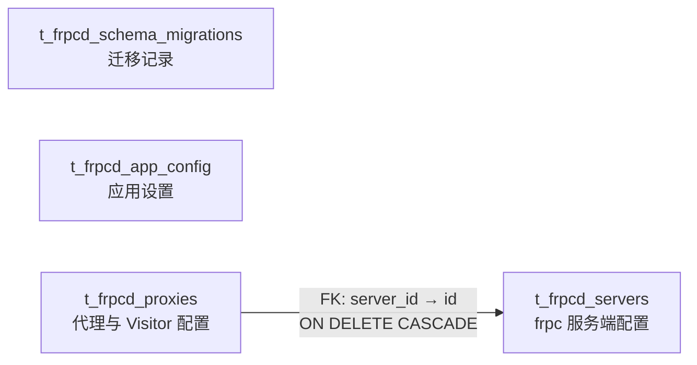

# SQLite 数据库设计（Android）

## 1. 文档目的

本文档描述 Frpc-Android 的 SQLite 持久化设计，基准对象为 `FrpcServerConfig`（服务端 + 应用设置）
与 `FrpcProxy`（代理/Visitor）。约束如下：

- 单一 SQLite 文件，位于应用私有数据目录，前端不直接访问；
- 应用设置与服务端连接配置分离存放；
- 布尔、状态、端口等字段在数据库层有明确约束；
- 支持事务与版本化迁移，迁移失败时安全中止；
- 只保留 Android 端真正用到的表：桌面端的「frpc 版本管理」表已在迁移 004 中删除。

实现位于 `src-tauri/src/db/`（rusqlite，bundled SQLite）与 `src-tauri/migrations/`。

## 2. 数据库文件与连接

### 2.1 位置

- 文件名：`frpc-android.sqlite3`
- 目录：`<应用私有数据目录>/db/`。Tauri 的 `app.path().app_data_dir()` 在 Android 上解析为
  应用私有数据根，实测路径为 `/data/data/priv.fdmdf.frpc.android/db/frpc-android.sqlite3`，
  同目录下还有 `config/frpc.toml` 与 `log/`，卸载应用时一起清除。

桌面版曾把数据库放在系统配置目录（`Frpc-Desktop/db/frpc-desktop.sqlite3`），
Android 版不使用该路径，也不读取桌面版遗留数据。

### 2.2 连接参数

每个连接建立后执行：

```sql
PRAGMA foreign_keys = ON;
PRAGMA journal_mode = WAL;
PRAGMA synchronous = NORMAL;
PRAGMA busy_timeout = 5000;
```

- `foreign_keys` 必须按连接开启，否则外键声明不生效；
- Rust 后端是唯一写入方，前端只能走 IPC；
- 关闭或备份前需要正确处理 WAL checkpoint，`-wal` / `-shm` 文件不手工修改。

### 2.3 命名与类型

- 表名、列名使用 `snake_case`；
- TypeScript `_id` 映射到 `id TEXT PRIMARY KEY`，Repository 返回对象时映射回 `_id`；
- `boolean` 映射为 `INTEGER NOT NULL CHECK (value IN (0, 1))`；
- 代理的 `local_port`、`remote_port` 保持 `TEXT`，因为支持单端口、逗号列表与端口范围；
- 复杂对象与数组以 JSON 文本保存，并用 `CHECK (json_valid(...))` / `json_type(...)` 校验。

## 3. 表结构

业务表与迁移记录统一使用 `t_frpcd_` 前缀。

### 3.1 数据关系图



`server_id` 是外键；`t_frpcd_app_config` 的 `scope_id` 为多态预留，当前只有 `global` 作用域，不建外键。

### 3.2 `t_frpcd_schema_migrations`

| 字段 | 类型 | 约束 | 说明 |
| --- | --- | --- | --- |
| `version` | INTEGER | PRIMARY KEY | 单调递增的迁移版本 |
| `name` | TEXT | NOT NULL | 迁移名称 |
| `applied_at` | TEXT | NOT NULL | UTC ISO 8601 时间 |

### 3.3 `t_frpcd_app_config`

Key-Value 模型，保存应用自身设置。一个配置项一行，新增配置不需要改表结构。

| 字段 | 类型 | 可空 | 默认值 | 说明 |
| --- | --- | --- | --- | --- |
| `id` | TEXT | 否 | — | 主键，UUID，应用层生成 |
| `scope_type` | TEXT | 否 | `'global'` | 作用域：global / user / project |
| `scope_id` | TEXT | 是 | NULL | 作用域对象 ID；global 必须为空 |
| `namespace` | TEXT | 否 | — | 命名空间，用于区分功能模块 |
| `config_key` | TEXT | 否 | — | 配置键 |
| `value_type` | TEXT | 否 | `'string'` | string / integer / boolean / json |
| `config_value` | TEXT | 否 | — | 统一以文本存储，按 `value_type` 解析 |
| `is_secret` | INTEGER | 否 | 0 | 1-敏感、0-普通 |
| `encryption_type` | TEXT | 是 | NULL | 非敏感必须为空；敏感可用 aes-256-gcm |
| `version` | INTEGER | 否 | 1 | 乐观锁版本号 |
| `created_at` | TEXT | 否 | 当前 UTC 时间 | 创建时间 |
| `updated_at` | TEXT | 否 | 当前 UTC 时间 | 更新时间 |
| `deleted_at` | TEXT | 是 | NULL | 软删除时间 |

当前 Android 版使用的全局配置：

| namespace | config_key | value_type | 默认值 | 对应属性 |
| --- | --- | --- | --- | --- |
| `app` | `auto_connect_on_startup` | `boolean` | `false` | `system.autoConnectOnStartup` |
| `app` | `language` | `string` | `en-US` | `system.language` |
| `onboarding` | `guide_completed` | `boolean` | `false` | 新手引导完成标记，不受「重置全部配置」影响 |

桌面端的 `desktop/launch_at_startup` 与 `desktop/silent_startup` 已随桌面端移除；
Android 端由前台服务保活，不再提供开关。

`config_value` 解析规则：`string` 直接返回文本；`integer` 严格校验十进制整数；
`boolean` 只接受 `true` / `false`；`json` 写入前序列化校验、读取后解析；
`is_secret = 1` 时 `config_value` 保存密文，解密后再按 `value_type` 解析。

### 3.4 `t_frpcd_servers`

保存 frpc 公共配置与服务端连接配置，当前只允许一条 `id = "1"` 的记录。

| 字段 | 类型 | 约束/默认值 | 对应属性 |
| --- | --- | --- | --- |
| `id` | TEXT | PRIMARY KEY；固定 `"1"` | `_id` |
| `multiuser` | INTEGER | NOT NULL DEFAULT 0；0/1 | `multiuser` |
| `user` | TEXT | NOT NULL DEFAULT `''` | `user` |
| `server_addr` | TEXT | NOT NULL DEFAULT `''` | `serverAddr` |
| `server_port` | INTEGER | NOT NULL DEFAULT 7000；1–65535 | `serverPort` |
| `login_fail_exit` | INTEGER | NOT NULL DEFAULT 0；0/1 | `loginFailExit` |
| `udp_packet_size` | INTEGER | NOT NULL DEFAULT 1500；> 0 | `udpPacketSize` |
| `auth_json` | TEXT | NOT NULL；合法 JSON 对象 | `auth` 完整对象 |
| `log_json` | TEXT | NOT NULL；合法 JSON 对象 | `log` 完整对象 |
| `web_server_json` | TEXT | NOT NULL；合法 JSON 对象 | `webServer` 完整对象 |
| `transport_json` | TEXT | NOT NULL；合法 JSON 对象 | `transport` 完整对象（含 `tls`） |
| `metadatas_json` | TEXT | NOT NULL DEFAULT `'{}'`；合法 JSON 对象 | `metadatas` |

迁移 004 删除了 `frpc_version`（指定 frpc 版本）与 `custom_frpc_path`（自定义二进制路径）
两列：Android 端 frpc 由 APK 内置为 `jniLibs/<abi>/libfrpc.so`，且 Android 10+ 只允许从
`nativeLibraryDir` 执行 ELF，这两个桌面端概念无对应实现。

`auth_json`、`web_server_json`、`transport_json` 中可能含 token、密码、证书路径或代理地址，
不得完整输出到日志或错误上报。

### 3.5 `t_frpcd_proxies`

普通代理与 visitor 共用一张表，通过 `visitors_model` 区分。

| 字段 | 类型 | 约束/默认值 | 对应属性 |
| --- | --- | --- | --- |
| `id` | TEXT | PRIMARY KEY | `_id` |
| `server_id` | TEXT | NOT NULL DEFAULT `'1'`；外键 | 所属 server |
| `name` | TEXT | NOT NULL DEFAULT `''` | `name` |
| `type` | TEXT | NOT NULL；http/https/tcp/udp/stcp/xtcp/sudp | `type` |
| `local_ip` | TEXT | NOT NULL DEFAULT `''` | `localIP` |
| `local_port` | TEXT | NOT NULL DEFAULT `'8080'` | `localPort` |
| `remote_port` | TEXT | NOT NULL DEFAULT `'8080'` | `remotePort` |
| `custom_domains_json` | TEXT | NOT NULL DEFAULT `'[""]'`；JSON 数组 | `customDomains` |
| `locations_json` | TEXT | NOT NULL DEFAULT `'[""]'`；JSON 数组 | `locations` |
| `host_header_rewrite` | TEXT | NOT NULL DEFAULT `''` | `hostHeaderRewrite` |
| `visitors_model` | TEXT | NOT NULL DEFAULT `'visitors'` | `visitorsModel` |
| `server_user` | TEXT | NOT NULL DEFAULT `''` | `serverUser` |
| `server_name` | TEXT | NOT NULL DEFAULT `''` | `serverName` |
| `secret_key` | TEXT | NOT NULL DEFAULT `''` | `secretKey` |
| `bind_addr` | TEXT | NOT NULL DEFAULT `''` | `bindAddr` |
| `bind_port` | INTEGER | NULL；为空或 1–65535 | `bindPort` |
| `subdomain` | TEXT | NOT NULL DEFAULT `''` | `subdomain` |
| `basic_auth` | INTEGER | NOT NULL DEFAULT 0；0/1 | `basicAuth` |
| `http_user` | TEXT | NOT NULL DEFAULT `''` | `httpUser` |
| `http_password` | TEXT | NOT NULL DEFAULT `''` | `httpPassword` |
| `fallback_to` | TEXT | NOT NULL DEFAULT `''` | `fallbackTo` |
| `fallback_timeout_ms` | INTEGER | NOT NULL DEFAULT 500；>= 0 | `fallbackTimeoutMs` |
| `https2http` | INTEGER | NOT NULL DEFAULT 0；0/1 | `https2http` |
| `https2http_ca_file` | TEXT | NOT NULL DEFAULT `''` | `https2httpCaFile` |
| `https2http_key_file` | TEXT | NOT NULL DEFAULT `''` | `https2httpKeyFile` |
| `tls2raw` | INTEGER | NOT NULL DEFAULT 0；0/1 | `tls2raw`（迁移 002） |
| `tls2raw_ca_file` | TEXT | NOT NULL DEFAULT `''` | `tls2rawCaFile`（迁移 002） |
| `tls2raw_key_file` | TEXT | NOT NULL DEFAULT `''` | `tls2rawKeyFile`（迁移 002） |
| `keep_tunnel_open` | INTEGER | NOT NULL DEFAULT 0；0/1 | `keepTunnelOpen` |
| `status` | INTEGER | NOT NULL DEFAULT 1；0/1 | `status` |
| `transport_json` | TEXT | NOT NULL；合法 JSON 对象 | `transport` 完整对象 |

不对代理名称加唯一约束：历史数据可能存在重名，迁移不能因此失败。

### 3.6 外键与索引

| 名称 | 表 | 类型 | 字段 | 用途 |
| --- | --- | --- | --- | --- |
| `fk_t_frpcd_proxies_server` | `t_frpcd_proxies` | FOREIGN KEY | `server_id → t_frpcd_servers.id` | ON UPDATE/DELETE CASCADE |
| `pk_t_frpcd_schema_migrations` | `t_frpcd_schema_migrations` | PRIMARY KEY | `version` | 迁移版本唯一 |
| `uq_t_frpcd_app_config_active` | `t_frpcd_app_config` | UNIQUE PARTIAL | `scope_type, COALESCE(scope_id, ''), namespace, config_key`（`deleted_at IS NULL`） | 同名有效配置唯一 |
| `idx_t_frpcd_app_config_lookup` | `t_frpcd_app_config` | INDEX | `scope_type, scope_id, namespace, deleted_at` | 批量读取有效配置 |
| `pk_t_frpcd_servers` | `t_frpcd_servers` | PRIMARY KEY | `id` | 定位服务端配置 |
| `pk_t_frpcd_proxies` | `t_frpcd_proxies` | PRIMARY KEY | `id` | 定位代理 |
| `idx_t_frpcd_proxies_server_status` | `t_frpcd_proxies` | INDEX | `server_id, status` | 按 server 查询与启用过滤 |

## 4. 迁移

| 版本 | 文件 | 说明 |
| --- | --- | --- |
| 001 | `001_initial_schema.sql` | 初始 schema（含 `t_frpcd_versions`，004 会删掉） |
| 002 | `002_tls2raw_plugin.sql` | 新增 `tls2raw` 三个字段 |
| 003 | `003_custom_frpc_path.sql` | 新增 `custom_frpc_path`（004 会删掉） |
| 004 | `004_android_only_cleanup.sql` | 删除 `t_frpcd_versions`，删除 `frpc_version` / `custom_frpc_path` 两列 |

`DbManager::init()` 启动时按版本号补齐未执行的迁移，再初始化默认配置。
003 仍然先执行一次，保证 004 的 `DROP COLUMN` 在旧库上也有目标列。

兼容性测试见 `src-tauri/src/db/mod.rs`：`drops_legacy_version_table_on_upgrade`
构造一份「桌面版遗留」数据库（迁移只到 003、带版本记录与 `custom_frpc_path`），
校验升级到 004 后版本表与两列被清理、服务端与代理数据仍可正常读写。

## 5. Repository 映射与事务边界

Repository 负责 `_id`/`id`、camelCase/snake_case、`0/1`/boolean、JSON 字段的双向转换，
并把 SQLite 的「未找到记录」映射成调用方可处理的空值。

| Repository | 方法 | 说明 |
| --- | --- | --- |
| `AppConfigRepository` | `find_effective` / `find_by_namespace` / `upsert` / `soft_delete` | 应用设置读写，`upsert` 带乐观锁 |
| `AppConfigRepository` | `is_guide_completed` / `save_guide_completed` | 新手引导状态 |
| `ServerRepository` | `get_server_config` / `save_server_config` / `reset_all_config` | 读取时补入应用设置形成 `system`，保存时同事务拆分写入 |
| `ProxyRepository` | 增删改查 / `update_proxy_status` | 代理与 visitor |

必须在事务中执行的操作：

- 保存完整配置（同时更新 app config 与 server）；
- 导入配置时保存 server 并批量新增代理；
- 全量重置配置。

启动/停止 frpc、写 TOML 等文件操作不应长时间占用事务：先完成文件操作，再用短事务写库，失败时做补偿清理。

## 6. 安全与维护

- 数据库只由 Rust 后端访问，前端必须走 IPC；
- 后端继续校验前端传入的 ID、端口、状态与路径；
- 日志只记录操作类型、记录 ID 与错误码，不记录 token、密码、secret key 或证书内容；
- 「重置全部配置」事务性清空业务数据，并保留新手引导标记；
- 备份优先使用 SQLite backup API，直接复制前必须 checkpoint；
- 避免在每次启动时执行 `VACUUM`。
